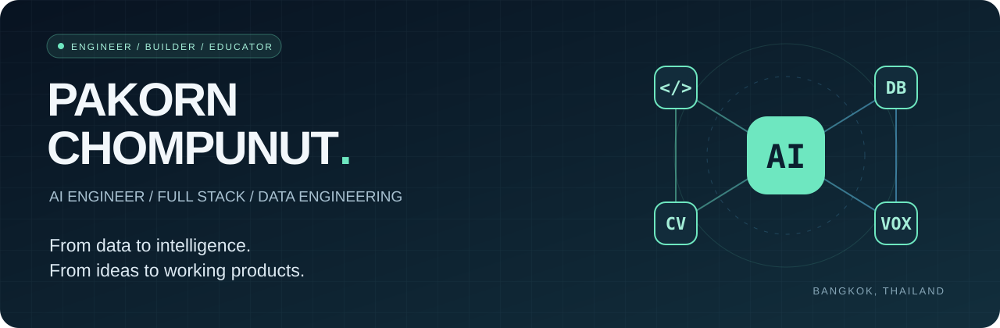

  

  <strong>AI Engineer · Full Stack & Data Engineering · Thailand</strong> 
  Real-time agents. Computer vision. Data systems that connect to the real world.

  <a href="#selected-work">Selected work</a> &nbsp; / &nbsp;
  <a href="#the-journey">The journey</a> &nbsp; / &nbsp;
  <a href="#toolbox">Toolbox</a> &nbsp; / &nbsp;
  <a href="mailto:pakorn.c@ntplc.co.th">Let's connect</a>

---

### สวัสดีครับ — I'm Pakorn 👋

I build at the intersection of **data, AI, and useful software**. Since 2014, my work at **National Telecom PLC.** has spanned enterprise CRM pipelines, customer information systems, interactive web applications, and real-time AI agents.

Today, I focus on turning AI ideas into working experiences: voice systems that listen and respond, vision models that run at the edge, and applications grounded in real data. My MBA and IT background help me connect engineering decisions with business needs.

> **จากข้อมูล สู่ AI ที่ใช้งานได้จริง** — ผมชอบสร้างระบบที่เชื่อมเทคโนโลยีเข้ากับโจทย์ธุรกิจ และถ่ายทอดความรู้ให้คนอื่นนำไปต่อยอดได้

## Selected work

<table>
<tr>
<td width="50%" valign="top">

### 01 / TripChan 🧭
**A bilingual AI guide for Chanthaburi**

Explore a 49-place catalog through Thai/English AI chat and generate structured 1–3 day itineraries. Includes a check-in, review, and rewards proof of concept.

`Agentic RAG` `React` `TypeScript` `Supabase`

[Explore the code ↗](https://github.com/pakornc2534/chanthaburi-ai-guide)

</td>
<td width="50%" valign="top">

### 02 / ElderCare Guardian 🛡️
**Privacy-first care workflow prototype**

A product demo exploring camera-free elder monitoring, risk explanations, alert escalation, and Thai voicebot outreach through simulated scenarios.

`React` `TypeScript` `Vite` `Recharts`

[Explore the code ↗](https://github.com/pakornc2534/guardian-thai-ai)

</td>
</tr>
<tr>
<td width="50%" valign="top">

### 03 / DataOps Pipeline ⚙️
**From raw loan data to SQL Server**

A Python ETL project with data cleaning, fact/dimension modeling, unit tests, and Jenkins pipeline orchestration.

`Python` `pandas` `SQL Server` `Jenkins`

[Explore the code ↗](https://github.com/pakornc2534/dataops-foundation-jenkins-new)

</td>
<td width="50%" valign="top">

### 04 / Vehicle Vision 🚘
**Computer vision from training to edge handoff**

Model-team contributor to a CCTV project deployed on NVIDIA Jetson Orin at Ang Sila Town Municipality, Chonburi. Worked on dataset quality, group-aware splits, model evaluation, and deployment artifacts.

`PyTorch` `MobileNetV3` `NVIDIA A100` `Jetson Orin`

Professional contribution · Super AI Engineer Season 6

</td>
</tr>
</table>

<strong>Behind the work — implementation details & scope</strong>

- **TripChan:** intent classification and place selection precede retrieval and streamed responses; place cards link back to catalog entries. The rewards flow is a local-state POC.
- **ElderCare Guardian:** local mock state and simulated sensors, risk scores, and calls. A care decision-support demo; clinical validation and live integrations are outside its current scope.
- **DataOps:** cleans CSV loan data, models fact and dimension tables, and runs tests before database deployment through Jenkins.
- **Vehicle Vision:** contributed to a **14,461-record dataset** and a MobileNetV3 Large multi-task model covering **33 vehicle brands / 8 colors**. Reported model test accuracy: **76.01% brand / 92.08% color**. These are holdout model results, not end-to-end deployment metrics.

### More things I've helped bring to life

| Project / contribution | My focus |
| :--- | :--- |
| **REDACTRA** · Aug 2026 | Co-developed local-first privacy workflows connecting vendor assessment, DPA, risk, and DPIA, with human review before data leaves the system. |
| **Prompy — NT AIoT Smart Home** · Aug 2026 | Coached Team Prompt on a Thai voice assistant integrating Home Assistant, Tuya, MoveNet fall detection, and YAMNet baby-cry detection. |
| **Real-Time Multimodal AI Agents Framework** | STT → LLM → TTS pipeline with LiveKit / WebRTC for real-time voice interaction. |

## The journey

**2014 → now · Build**  
Senior Computer Specialist at **National Telecom PLC.** — enterprise data pipelines, customer information systems, web applications, and multi-agent AI.

**2024 → now · Share**  
In-house instructor at **National Telecom Academy** — *AI for Work: Generative AI 101*, *Storytelling with Data*, and *UX/UI Design*.

**2025 → 2026 · Explore & compete**

| When | Recognition | Project / event |
| :--- | :--- | :--- |
| Sep 2026 | 🥉 Bronze Medal | Super AI Engineer Season 6 · Vehicle Vision |
| Sep 2026 | Finalist | Dictionary Reimagined Hackathon · Office of the Royal Society × NECTEC |
| Aug 2026 | 🗳️ Popular Vote | PDPA Hackathon 2026 by PDPC · REDACTRA |
| May 2026 | Honorable Mention | OpenAI × AIAT Hackathon · Life Guardian |
| Oct 2025 | 🥈 First Runner-up | NT Agentic AI Hackathon · Real-Time Multimodal AI Agents Framework |
| Sep 2025 | 🏆 Winner | NT Big Idea · AI Service Solution |

## Toolbox

| Area | Technologies I work with |
| :--- | :--- |
| **AI & computer vision** | Python · PyTorch · multi-task learning · model evaluation |
| **Agents & voice** | LangChain · LiveKit / WebRTC · STT / LLM / TTS · MCP · n8n |
| **Full stack** | ASP.NET · Next.js · React · TypeScript |
| **Data & analytics** | SQL Server · SSIS · PySpark / Spark · Kafka · Qdrant · Power BI · Tableau |
| **Deployment & compute** | Docker · Git · CI/CD · NVIDIA Jetson Orin · HPC / Slurm |

<strong>Education & credentials</strong>

- **MBA** — Ramkhamhaeng University
- **B.Sc. in Information Technology** — Rangsit University
- **HCCDA-AI Developer Certification** — Huawei Cloud
- **Super AI Engineer Season 6** — AI Association of Thailand (AIAT)
- **Languages:** Thai · English (TOEIC 635)

---

  <strong>Let's turn a good problem into something useful.</strong> 
  AI agents · computer vision · data engineering · knowledge sharing  
  <a href="mailto:pakorn.c@ntplc.co.th">pakorn.c@ntplc.co.th</a> &nbsp; · &nbsp;
  <a href="https://github.com/pakornc2534?tab=repositories">Browse all repositories ↗</a>

