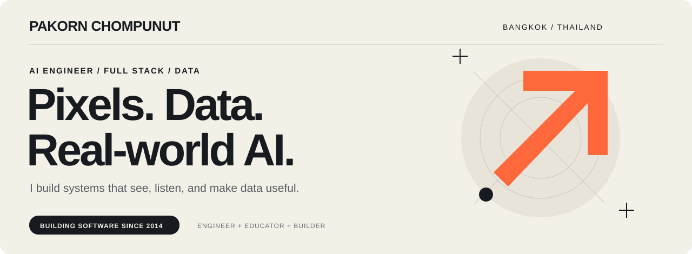
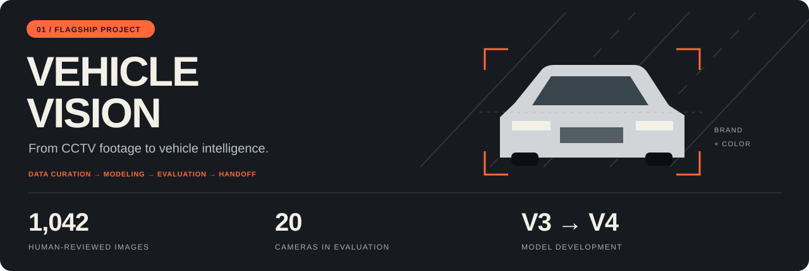
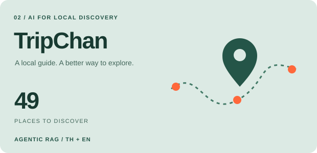
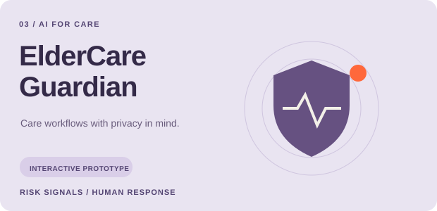

  <a href="#vehicle-vision"><strong>FLAGSHIP WORK</strong></a> &nbsp; / &nbsp;
  <a href="#more-things-i-build">MORE PROJECTS</a> &nbsp; / &nbsp;
  <a href="#a-little-about-me">ABOUT ME</a> &nbsp; / &nbsp;
  <a href="mailto:pakorn.c@ntplc.co.th">LET'S TALK ↗</a>

### สวัสดีครับ, I'm Pakorn.

An **AI engineer and software builder at National Telecom PLC.**, with a background in enterprise data systems since 2014. I work across **computer vision, real-time voice agents, and full-stack applications** — from preparing the data to making the system usable.

My current deep dive: **teaching AI to recognize vehicles in real CCTV footage**, where a new camera angle can change everything.

## Vehicle Vision

### The hard part starts when the camera changes.

Small crops. Unfamiliar angles. Similar-looking brands. I work on the **model and data side** of Vehicle Vision: developing vehicle-brand and color classification, reviewing labels, testing across cameras, and preparing model packages for the deployment team targeting **NVIDIA Jetson AGX Orin**.

**From a hackathon contribution to an ongoing model-development effort.** The work has progressed from MobileNetV3 to MobileNetV4, with human-review tools, duplicate screening, per-camera evaluation, and controlled experiments on difficult vehicle classes.

<table>
<tr>
<td width="33%" align="center"><h3>81.29%</h3><strong>Vehicle brand</strong> 847 / 1,042 images</td>
<td width="33%" align="center"><h3>88.29%</h3><strong>Vehicle color</strong> 920 / 1,042 images</td>
<td width="33%" align="center"><h3>20 cameras</h3><strong>Same-image comparison</strong> Human-reviewed reference labels</td>
</tr>
</table>

MobileNetV4 v010A · 12 Oct 2026 evaluation · image-level top-1, all 1,042 available vehicle images, no confidence filtering. Brand accuracy was 48.75% for the evaluated V3 checkpoint on these same images. This is an evaluation result, not a claim of live-system accuracy or Jetson speed.

**What I bring to the work**

- **Data that can be checked:** AI-assisted labeling with human review, duplicate audits, and explicit train/dev/evaluation boundaries.
- **Experiments that explain the tradeoffs:** V3/V4 comparisons, frozen-encoder trials, targeted data additions, and reviews of which brands improve or regress.
- **A practical handoff:** checkpoints, class maps, preprocessing, inference configuration, and evidence for the deployment team.

**Latest · 14 Oct 2026** — Formula C selected for deployment-team testing. On the reused, AI-labeled development set, brand accuracy is **89.00% (704/791)** and color accuracy is **89.43% (770/861)**. Fresh-data validation remains the next test; Nissan regression is a known tradeoff.

**[Read the engineering case study →](VEHICLE_VISION.md)**

`PyTorch` `MobileNetV4` `Computer vision` `Human-in-the-loop` `Edge AI`

## More things I build

<table>
<tr>
<td width="50%" valign="top">

### An AI guide with local knowledge.

**TripChan** helps people explore Chanthaburi through Thai/English chat grounded in a **49-place catalog**, structured 1–3 day itineraries, and a check-in/rewards POC.

`Agentic RAG` `React` `TypeScript` `Supabase`

**[Explore TripChan ↗](https://github.com/pakornc2534/chanthaburi-ai-guide)**

</td>
<td width="50%" valign="top">

### Turn risk signals into care workflows.

**ElderCare Guardian** explores camera-free monitoring, explainable risk signals, escalation, and Thai voicebot outreach. An interactive product prototype using **simulated sensors and calls**.

`React` `TypeScript` `Recharts` `Product prototyping`

**[Explore Guardian ↗](https://github.com/pakornc2534/guardian-thai-ai)**

</td>
</tr>
</table>

**Also in my workshop**

- **[DataOps Pipeline ↗](https://github.com/pakornc2534/dataops-foundation-jenkins-new)** — loan CSV → cleaning → fact/dimension tables → SQL Server, with Python tests and Jenkins orchestration.
- **REDACTRA** — co-developed local-first privacy workflows for vendor assessment, DPA, risk, and DPIA; human review before data leaves the system.
- **Prompy / NT AIoT Smart Home** — coached Team Prompt on Thai voice control, Home Assistant/Tuya, and vision/audio sensing.
- **Real-time multimodal agents** — connecting STT → LLM → TTS through LiveKit / WebRTC.

## Recognition along the way

| 2026 | 2025 |
| :--- | :--- |
| **Bronze Medal** · Super AI Engineer Season 6 Vehicle Vision | **Winner** · NT Big Idea AI Service Solution |
| **Popular Vote** · PDPA Hackathon by PDPC REDACTRA | **First Runner-up** · NT Agentic AI Hackathon Real-Time Multimodal AI Agents Framework |
| **Honorable Mention** · OpenAI × AIAT Hackathon Life Guardian | |
| **Finalist** · Dictionary Reimagined Hackathon Office of the Royal Society × NECTEC | |

## A little about me

**Build → test → explain → improve.** That's the part of engineering I enjoy: turning an idea into something people can inspect, use, and make better.

At **National Telecom**, I've worked on enterprise CRM pipelines, customer information systems, and interactive applications since 2014. Since 2024, I've also taught **Generative AI, data storytelling, and UX/UI** at National Telecom Academy.

> ผมชอบงานที่ได้ลงมือทั้งข้อมูล โมเดล และระบบ — แล้วอธิบายให้คนใช้และทีมที่รับช่วงต่อเข้าใจได้จริง

<table>
<tr>
<td width="33%" valign="top"><strong>SEE & LISTEN</strong>  Python · PyTorch LangChain · LiveKit STT / LLM / TTS · MCP · n8n</td>
<td width="34%" valign="top"><strong>BUILD & CONNECT</strong>  ASP.NET · Next.js React · TypeScript Docker · Git · CI/CD</td>
<td width="33%" valign="top"><strong>MOVE & UNDERSTAND DATA</strong>  SQL Server · SSIS Spark / PySpark · Kafka · Qdrant Power BI · Tableau · HPC / Slurm</td>
</tr>
</table>

<strong>Education & credentials</strong>

MBA — Ramkhamhaeng University · B.Sc. Information Technology — Rangsit University  
HCCDA-AI Developer — Huawei Cloud · Super AI Engineer Season 6 — AIAT  
Thai · English (TOEIC 635)

---

### Have a real-world AI problem in mind?

I'm interested in conversations about **computer vision, real-time agents, data engineering, and making AI useful in practice**.

**[Let's talk ↗](mailto:pakorn.c@ntplc.co.th)** &nbsp; · &nbsp; **[Browse my repositories ↗](https://github.com/pakornc2534?tab=repositories)**

Pakorn Chompunut · ภากร ชมภูนุช · Bangkok, Thailand
